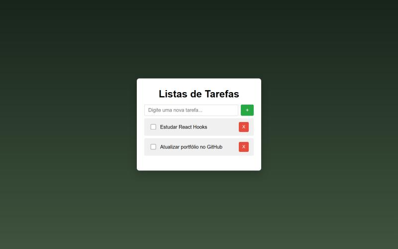

# ✅ Lista de Tarefas (To-Do List)

Aplicação de lista de tarefas responsiva feita com **JavaScript puro** (sem frameworks), como projeto final do módulo de Fundamentos de JavaScript da Escola DNC.

🔗 **Ver online:** https://mgarajau.github.io/task-list/



## ✨ Funcionalidades

- Adicionar novas tarefas
- Marcar tarefas como concluídas
- Remover tarefas
- Tarefas salvas no **localStorage**, então continuam lá ao recarregar a página
- Layout responsivo

## 🧠 O que pratiquei

- Manipulação do **DOM** (criar, inserir e remover elementos dinamicamente)
- **Eventos** (`addEventListener`)
- Arrays e métodos como `filter` e `push`
- Persistência de dados com `localStorage` e `JSON.stringify`/`JSON.parse`

## 🛠️ Tecnologias


## ▶️ Como rodar

Basta clonar o repositório e abrir o `index.html` no navegador:

```bash
git clone https://github.com/mgarajau/task-list.git
```

## 👤 Autor

**Matheus Garajau** · [LinkedIn](https://www.linkedin.com/in/matheus-garajau/) · [GitHub](https://github.com/mgarajau)
